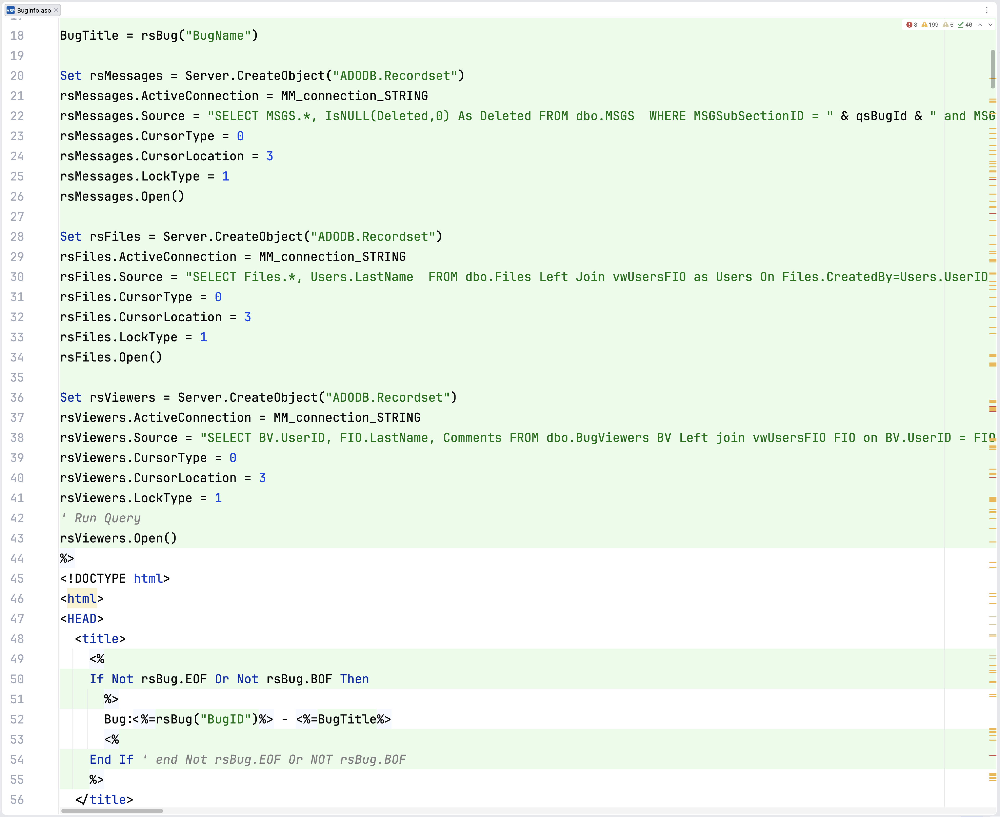

# ASP Classic Language Support for JetBrains IDEs

An IntelliJ Platform plugin that adds support for **ASP Classic** files with **VBScript** engine (`.asp`, `.inc`).

Modern IDEs often lack proper support for legacy technologies like ASP Classic. 
This plugin aims to make the maintenance of legacy codebases more comfortable by providing essential IDE features within PhpStorm, IntelliJ IDEA, WebStorm, and other JetBrains tools.

## Current Status

The stable `1.0.0` release is published on JetBrains Marketplace and is ready
for day-to-day navigation and editing of ASP Classic projects. Version `1.1.0`
is prepared locally as a focused selection-aware formatting update but has not
yet been tagged or published. Both lines require IntelliJ Platform build
`252.27397` or later.

### Tested IDEs

| IDE | Version and build | Validation |
| --- | --- | --- |
| PhpStorm | 2025.2.4 (`PS-252.27397.112`) | Compatibility baseline: complete 224-test suite and Plugin Verifier |
| PhpStorm | 2026.2.3 (`PS-262.10968.76`) | Primary development target: complete 224-test suite, full TTS corpus audit, and real-project manual use |
| IntelliJ IDEA Ultimate | 2026.2.2 (`IU-262.10315.125`) | Plugin Verifier and a 108-test functional smoke suite |
| WebStorm | 2026.2.2 (`WS-262.10315.144`) | Plugin Verifier and a 108-test functional smoke suite |
| PyCharm | 2026.2.3 (`PY-262.10968.92`) | Plugin Verifier, a 108-test functional smoke suite, and manual demo-project validation |

Marketplace may offer the plugin in additional IntelliJ Platform products when
their declared platform modules satisfy the plugin dependencies. Those products
have not yet been tested by the project; please report product-specific issues
with the IDE name and exact build number.

### Feedback

If the plugin helps with your ASP Classic project, please consider leaving an
[honest Marketplace review](https://plugins.jetbrains.com/plugin/34424-asp-classic-language-support/reviews).
Bug reports and feature suggestions are welcome through the repository's
[issue forms](https://github.com/Dvamuch/asp-classic-language-support/issues/new/choose).
Please include the IDE name, exact build number and plugin version.

Version 1.0.0 may show this invitation once after at least a week and eight ASP,
INC or VBS file openings. The prompt is non-modal, is never repeated, and does
not collect or transmit telemetry.

### What works now:
- **File Recognition**: Supports `.asp`, `.inc` and `.vbs` files.
- **ASP Parsing**: Correctly identifies `<% ... %>` and `<%= ... %>` blocks.
- **Syntax Highlighting**: 
    - Basic VBScript syntax highlighting.
    - Special highlighting for variables (identifiers) to improve readability.
- **Native ASP PSI**: Parses all scriptlets in an ASP file as one file-wide
  VBScript context without synthetic multi-host injection.
- **Basic HTML Support**: HTML parts of the ASP files are handled by the IDE's built-in HTML support.
- **Keyword Case Style**: `Editor | Code Style | VBScript` uses `Title Case` by
  default and can instead preserve existing keyword case or enforce `lower case`.
- **ASP Delimiter Style**: the same settings page controls spaces inside
  `<% ... %>` / `<%= ... %>` and whether paired delimiters keep consistent
  inline or multiline placement; both options are enabled by default.
- **VBScript Navigation**: "Jump to Definition" for scope-aware local symbols and top-level symbols from direct or nested includes.
- **Include Navigation**: Resolves `file` and `virtual` paths in `<!-- #include ... -->` directives.
- **Missing Include Inspection**: Highlights an unresolved relative or virtual
  include path without affecting ordinary HTML comments.
- **Undeclared Identifier Inspection**: With `Option Explicit`, highlights
  unresolved root names while treating dynamic object/COM members conservatively
  and resolving symbols from ASP includes.
- **Find Usages**: Finds local and include-aware symbol usages and reverse include dependencies.
- **Completion and Parameter Info**: Completes visible symbols, ASP built-ins and
  documented members of common ADO, Scripting Runtime, MSXML, WinHTTP and
  RegExp objects.
- **User Classes and `With`**: Resolves and completes public members of objects
  created with `New`, including classes from ASP includes, direct user-class
  return chains, `(New ClassName).Member`, `Me`, and qualified/nested `With`;
  `With` completion also supports ASP built-ins and known COM types.
- **Editor Features**: Line commenting, semantic folding, Structure View and
  matching of paired VBScript block keywords.
- **Formatting**: Formats `.vbs`, `.asp` and `.inc`, including mixed HTML and
  VBScript control flow spanning multiple scriptlets, spaces VBScript operators
  even in incomplete legacy fragments, preserves inline delimiter pairs, and
  normalizes line continuations, including multiline block-opening statements.
  The current development version can apply the same rules to selected whole
  lines without changing surrounding lines.
- **Safe Compound Attributes**: HTML file/URL quick-fixes preserve embedded ASP
  expressions inside attribute values.
- **Reformat Safety Guard**: Captures the document before platform formatting
  and restores it if the complete operation changes code tokens or introduces
  new ASP parser errors.

### Visual Demonstration

*Support for syntax highlighting and scriptlet blocks.*

## Roadmap

- [x] **Native ASP Architecture**: Keep one file-wide VBScript PSI while preserving the HTML template-data PSI.
- [x] **Performance Baseline**: Parse the complete TTS corpus without hangs and avoid unconditional project-wide resolve searches.
- [x] **Include Navigation**: Resolve `file` and `virtual` paths in `<!-- #include ... -->`.
- [x] **Include-aware Symbol Navigation**: Resolve top-level symbols through direct, nested, `file`, and `virtual` includes.
- [x] **Formatter MVP**: Format VBScript and mixed ASP/HTML while preserving scriptlet content.
- [x] **Editor Essentials**: Commenting, folding, Structure View and block matching.
- [x] **Code Completion MVP**: Complete VBScript/ASP symbols and documented members of common COM objects.
- [x] **Formatter Hardening**: Preserve code across full/partial formatting,
  cancellation, stale commands and document changes; keep large-file
  formatting idempotent and regression-tested.
- [x] **Selection-aware Formatting (first 1.1 feature)**: Apply VBScript
  spacing, keyword case and indentation only to selected ASP/INC/VBS lines,
  using surrounding control-flow context without modifying the rest of the
  document.
- [ ] **Advanced Symbol Model**: Extend user-class inference beyond direct `New` returns and add default members plus indexed project symbols.
- [ ] **Inspections**: Missing includes and conservative `Option Explicit`
  unresolved identifiers are covered; audit real projects, then add
  unused-declaration diagnostics without affecting editor responsiveness.
- [ ] **Global.asa**: Add its server-side script blocks and application/session lifecycle model.
- [x] **Stable Publication**: Version 1.0.0, its metadata, license, feedback
  links and plugin icons are published on JetBrains Marketplace and GitHub.

## Contributing

Contributions are very welcome! Since this is a niche tool for legacy technology, every bit of help counts.

If you want to help:
1. **Report bugs**: Open an issue if something isn't working as expected.
2. **Submit PRs**: If you know Kotlin and the IntelliJ SDK, feel free to pick up a task from the Roadmap.
3. **Suggestions**: Have an idea for a feature? Let's discuss it in the Issues.

Repository documentation, issue templates, release notes, and contributor-facing
text are maintained in English so contributors do not need to know the original
project author's language.

### Development Note

The compatibility and ordinary test baseline is **PhpStorm 2025.2.4
(PS-252.27397.112)**. PhpStorm 2026.2.3 remains the primary current development,
TTS corpus and real-project target. IntelliJ IDEA Ultimate and WebStorm 2026.2.2
plus PyCharm 2026.2.3 are covered by the cross-IDE smoke suite shown above. New
builds require platform 252.27397 or later. Gradle itself requires a Java 17+
launcher. Compilation and tests use Java 21 so one ZIP can run on both the
2025.2–2026.1 Java 21 platforms and the Java 25-based 2026.2 platform; Gradle
downloads the declared toolchain automatically when it is not installed locally.
Kotlin is 2.3.20 and is not bundled in the plugin ZIP.

Run the test suite, build a plugin ZIP, or launch an isolated development IDE:

```bash
./gradlew test
./gradlew buildPlugin
./gradlew verifyPlugin
./gradlew runIde
```

Marketplace updates are published by GitHub Actions when a GitHub Release is
published, or manually from the **Publish to JetBrains Marketplace** workflow.
The one-time token setup and release procedure are documented in
[`docs/PUBLISHING.md`](docs/PUBLISHING.md).

`verifyPlugin` checks the built plugin against the supported stable PhpStorm
line plus IntelliJ IDEA Ultimate, WebStorm and PyCharm. A locally installed
PhpStorm EAP can be included with `futurePhpstormIdePath`; keeping a moving EAP
out of the default matrix makes ordinary release checks reproducible. To run
the functional tests on a different locally installed IDE, pass its product
directory as `localIdePath`; the repository's cross-IDE validation uses a
focused smoke subset for products other than the primary PhpStorm target.

```bash
./gradlew test -PcrossIdeSmoke \
  -PlocalIdePath=/absolute/path/to/WebStorm.app/Contents

./gradlew verifyPlugin \
  -PfuturePhpstormIdePath=/absolute/path/to/PhpStorm-EAP.app/Contents
```

On macOS, when no system JDK is installed, the wrapper automatically uses the
JBR bundled with PhpStorm from `/Applications` (or `$HOME/Applications`) to
start Gradle. The build still selects the declared Java 21 toolchain for
compilation and tests. For a non-standard IDE location, point `JAVA_HOME` at
any Java 17+ runtime explicitly:

```bash
JAVA_HOME=/Applications/PhpStorm.app/Contents/jbr/Contents/Home ./gradlew test
```

To reuse the exact supported installation instead of downloading PhpStorm, pass
`-PlocalIdePath=/absolute/path/to/PhpStorm.app/Contents` to any of these commands.
The installation is read as an SDK; tests use separate runtime directories and
a sandbox, not your working IDE profile or Gradle's immutable SDK cache.
`AspPlatformCompatibilityTest` asserts the 2025.2.4 compatibility baseline by
default, so it is intentionally omitted from focused cross-IDE smoke runs. To
run the complete suite against another PhpStorm build, pass its exact build as
`expectedPlatformBuild`, for example:

```bash
./gradlew test \
  -PlocalIdePath=/absolute/path/to/PhpStorm.app/Contents \
  -PexpectedPlatformBuild=262.10968.76
```

The normal `test` task runs the repository fixtures and synthetic regressions.
Tests that depend on the external TTS checkout are skipped unless
`-PttsProjectDir` is supplied. The optional formatter audit only reads source
files and reformats in-memory copies. Run bounded batches with immediate
per-file progress:

```bash
./gradlew test --tests '*AspTtsFormattingSafetyTest' \
  -PttsProjectDir=/absolute/path/to/TTS -PttsPathFilter=Bugs/ \
  -PttsBatchSize=100 -PttsBatchIndex=0
```

The PhpStorm 2026.2 line has completed a full formatter safety audit of all
2203 supported files in the current TTS working tree (Git HEAD `189fed0`,
including its local uncommitted edits). The audit was repeated for the 1.1.0
selection-formatting candidate after the operator, continuation-indent,
delimiter-placement, multiline-attribute, default keyword-case and large-file
performance changes: no non-whitespace or ASP/VBScript token changes and no new
parser errors were detected. The audit does not write to the TTS checkout; it
fixes keyword case to `Preserve existing` so intentional style changes do not
mask the destructive-change checks.

The optional parser inventory is also read-only:

```bash
./gradlew test --tests '*AspTtsParserAuditTest' \
  -PttsProjectDir=/absolute/path/to/TTS
```

The last parser inventory, which covered 2200 files before the corpus gained
three additional files, reports 2158 clean files, 40 files with confirmed
source-code errors and 2 service files whose contents are not ASP. Parser code
has not changed since that inventory. The detailed classification is in
[`docs/TTS_PARSER_REVIEW_BACKLOG.md`](docs/TTS_PARSER_REVIEW_BACKLOG.md).

For real editor actions, selections, Undo, and important large files, run
`*AspEditorReformatSafetyTest` and `*AspFormattingModelSafetyTest` with
`-PttsProjectDir`. Their external-file cases need that property; a normal
`test` run does not constitute a TTS corpus audit.

### HTML formatter settings for legacy ASP

The HTML part of an ASP file is formatted by PhpStorm. For deeply nested legacy
pages such as TTS `customers/orderinfo.asp`, disable **Align text** under
`Editor | Code Style | HTML | Other`. With this option enabled, PhpStorm aligns
wrapped text to the preceding inline content and can produce hundreds of spaces;
this is independent of VBScript indentation. ASP expressions that start a new
line inside a quoted HTML attribute are aligned by the plugin to the attribute
line plus the configured HTML continuation indent.

### ASP delimiter settings

`Editor | Code Style | VBScript` contains two independent ASP options:

- **Spaces inside ASP delimiters** produces `<% code %>` and `<%= expression %>`.
- **Match opening and closing delimiter placement** keeps an inline pair inline;
  if either delimiter is separated from the VBScript by a line break, both are
  placed on their own aligned lines. A multiline delimiter line is also kept
  separate from following HTML.

Both are enabled by default. Formatting inside quoted HTML attributes remains
delegated mostly to PhpStorm's HTML formatter and is intentionally not
restructured by the delimiter-placement rule.

### Formatting a selection

The locally prepared 1.1.0 candidate supports selection-aware formatting in
`.asp`, `.inc`, and `.vbs`. Invoke **Reformat Code** with a selection to apply VBScript
spacing, keyword case, continuation indentation, and control-flow indentation
only to the touched physical lines. The formatter reads control-flow context
from the complete file, so a selected statement inside an `If`, `For`, `With`,
or another outer block receives the same indentation it would receive during a
whole-file reformat. Lines outside the expanded line range remain unchanged.

Selections are deliberately line-based: if the selection starts or ends in the
middle of a line, that complete line is formatted. ASP delimiter placement is
changed only when the complete scriptlet is inside the selected lines. Complex
ASP expressions embedded in quoted HTML attributes retain the limitations
described above. Marketplace version `1.0.0` predates this feature; it is
included in the locally prepared `1.1.0` candidate.

The detailed implementation status and prioritised backlog live in
[`DEVELOPMENT_PLAN.md`](DEVELOPMENT_PLAN.md). Formatter safety findings are in
[`docs/FORMATTER_SAFETY_INVESTIGATION.md`](docs/FORMATTER_SAFETY_INVESTIGATION.md).
Release boundaries are listed in
[`docs/KNOWN_LIMITATIONS.md`](docs/KNOWN_LIMITATIONS.md), while work intentionally
deferred past 1.0 lives in
[`docs/POST_1_0_ROADMAP.md`](docs/POST_1_0_ROADMAP.md).
The current candidate and validation record are in
[`docs/RELEASE_1_1.md`](docs/RELEASE_1_1.md); the stable 1.0 record is in
[`docs/RELEASE_1_0.md`](docs/RELEASE_1_0.md), and the original manual
acceptance checklist is retained in
[`docs/RELEASE_1_0_RC1.md`](docs/RELEASE_1_0_RC1.md).

## License
Distributed under the Apache License 2.0. See `LICENSE` for more information.

---
*Created by [Dvamuch](https://github.com/Dvamuch)*
